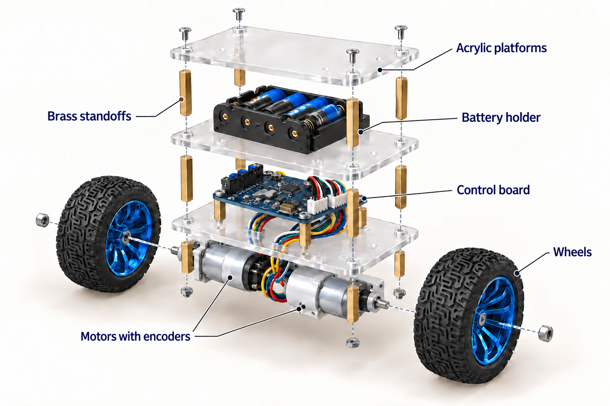
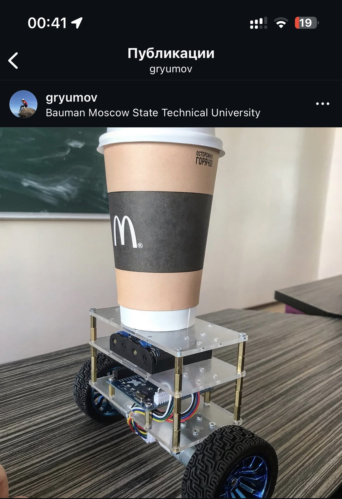

# Self-balancing robot

 

Two wheels, an STM32, and a little control theory. My project from 2019.

*Illustration based on the real robot; hidden details are approximate.*

## The story

I built this robot as a student: designed the PCB, worked with an accelerometer and a gyroscope, figured out the microcontroller registers, and tuned the motor control. This was before you could ask AI about every bit you did not understand.

I have wanted to preserve the project in an accessible form for a long time. Here are the robot, its firmware, and its circuit design, so others can explore it and build something of their own — and so I can someday show my kids what I used to build. 😄

## How it balances

The **MPU-6050** measures acceleration and angular velocity. The **STM32F103** combines these measurements with a complementary filter, estimates the tilt, and controls two motors through the **TB6612FNG**. The wheels move in the direction of the tilt, bringing the base back under the robot. Encoders provide feedback on wheel movement.

The frame consists of three acrylic platforms joined by brass standoffs. The motors and control board sit at the bottom, with the battery holder above. The firmware is written in C and accesses the STM32 registers directly.

## Find your way around

| What you need | Where to find it |
| --- | --- |
| Firmware | [firmware](firmware/README.md) — source code and Keil project |
| Circuit and PCB | [hardware/pcb](hardware/pcb) — Altium files and [PDF schematic](hardware/pcb/controller-schematic.pdf) |
| Platform dimensions | [hardware/enclosure](hardware/enclosure) — dimensioned sketch |
| Photos and illustrations | [images](images) |

## Build your own

You will need a board with an **STM32F103C8T6, MPU-6050, and TB6612FNG**, two geared motors with encoders, wheels, a 4×AA battery holder, acrylic, standoffs, and fasteners. [Hardware details](hardware/README.md).

1. Open the schematic and check the connections against your chosen PCB layout.
2. Assemble the frame and connect the sensor, encoders, and motors.
3. Open [robot.uvprojx](firmware/keil/robot.uvprojx) in Keil. See the [toolchain settings](firmware/README.md).
4. Check the sensor first, then each motor with the wheels off the ground.
5. Adjust the control polarity and gains for your hardware.

See the [firmware guide](firmware/README.md) for setup and tuning.

## The original robot

  

*May 18, 2019. Balancing with a coffee cup on top.*

## License

[MIT](LICENSE). Third-party files keep their own terms, listed in [THIRD-PARTY-NOTICES.md](THIRD-PARTY-NOTICES.md).
