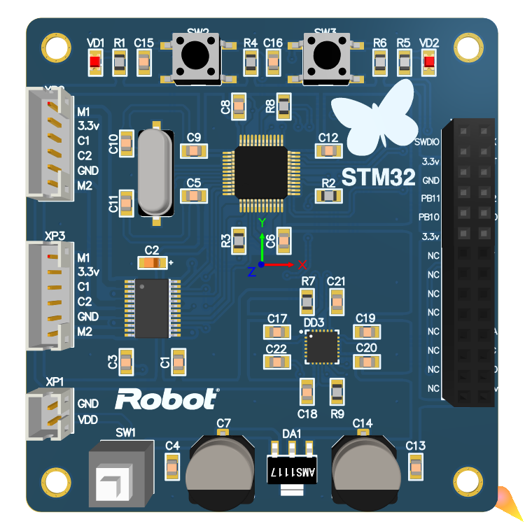

### Балансирующий робот
>Балансирующий робот представляет собой двухколесное транспортное средство, которое состоит из одной колесной пары и корпуса, на котором располагается система управления и аккумулятор.

#### Стукрура проекта
- [pcbDrawing](pbcDrawing)
    - [pcbDescription](pcbDrawing/pcbDescription)
    - [pdfDrawing](pcbDrawing/pdfDrawing)
    - pcbDrawing.dwg
- [pcbBoard](pcbBoard)
    - balancingRobot.PrjPCB
    - Schematic.SchDoc
    - pcbBoard.PcbDoc
    - gerber.OutJob
