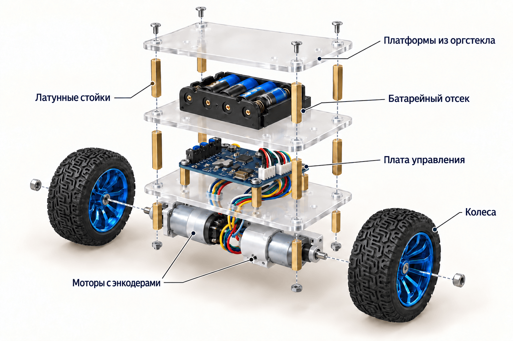
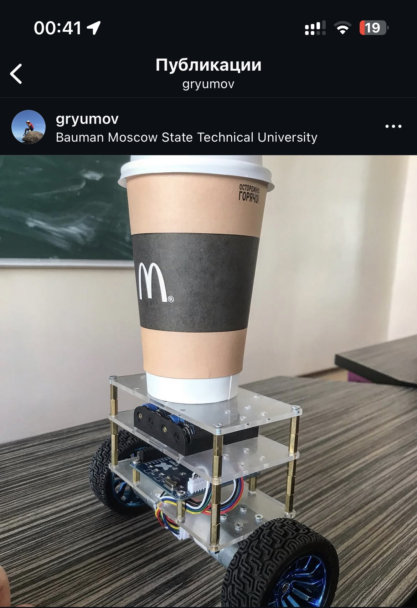

# Балансирующий робот

 

Два колеса, STM32 и немного теории управления. Мой проект 2019 года.

*Иллюстрация по фотографии настоящего робота; скрытые детали показаны условно.*

## История

Я собрал этого робота в студенческие годы: проектировал плату, работал с акселерометром и гироскопом, разбирался с регистрами микроконтроллера и настраивал управление двигателями. Все это — еще до того, как можно было спросить у ИИ про каждый непонятный бит.

Давно хотел сохранить проект в понятном виде. Здесь — сам робот, его программа и схема. Чтобы можно было разобраться, сделать что-то свое, а мне — когда-нибудь показать детям, что я собирал. 😄

## Как он держит равновесие

**MPU-6050** измеряет ускорение и угловую скорость. **STM32F103** объединяет их комплементарным фильтром, оценивает наклон и через **TB6612FNG** управляет двумя моторами. Колеса двигаются в сторону наклона, подводя опору под корпус. Энкодеры помогают учитывать движение колес.

Корпус собран из трех платформ из оргстекла на латунных стойках. Внизу — моторы и плата управления, выше — батарейный отсек. Программа написана на C с прямым обращением к регистрам STM32.

## Открыть проект

| Что нужно | Где лежит |
| --- | --- |
| Программа робота | [firmware](firmware/README.ru.md) — код и проект Keil |
| Схема и плата | [hardware/pcb](hardware/pcb) — Altium и [схема в PDF](hardware/pcb/controller-schematic.pdf) |
| Размеры платформы | [hardware/enclosure](hardware/enclosure) — эскиз с размерами |
| Фотографии и иллюстрации | [images](images) |

## Если хочется повторить

Нужны плата со **STM32F103C8T6, MPU-6050 и TB6612FNG**, два мотор-редуктора с энкодерами, колеса, отсек 4×AA, оргстекло, стойки и крепеж. [Подробнее о железе](hardware/README.ru.md).

1. Откройте схему и проверьте соединения выбранной платы.
2. Соберите механику и подключите датчик, энкодеры и двигатели.
3. Откройте [robot.uvprojx](firmware/keil/robot.uvprojx) в Keil. Настройки среды — [здесь](firmware/README.ru.md).
4. Сначала проверьте датчик, затем каждый мотор с вывешенными колесами.
5. Настройте знак и коэффициенты управления под свою механику.

Сборка и настройка программы описаны в [разделе прошивки](firmware/README.ru.md).

## Тот самый робот

  

*18 мая 2019 года. Держит равновесие со стаканом кофе.*

## Лицензия

[MIT](LICENSE). Сторонние файлы сохраняют свои условия, список в [THIRD-PARTY-NOTICES.md](THIRD-PARTY-NOTICES.md).
