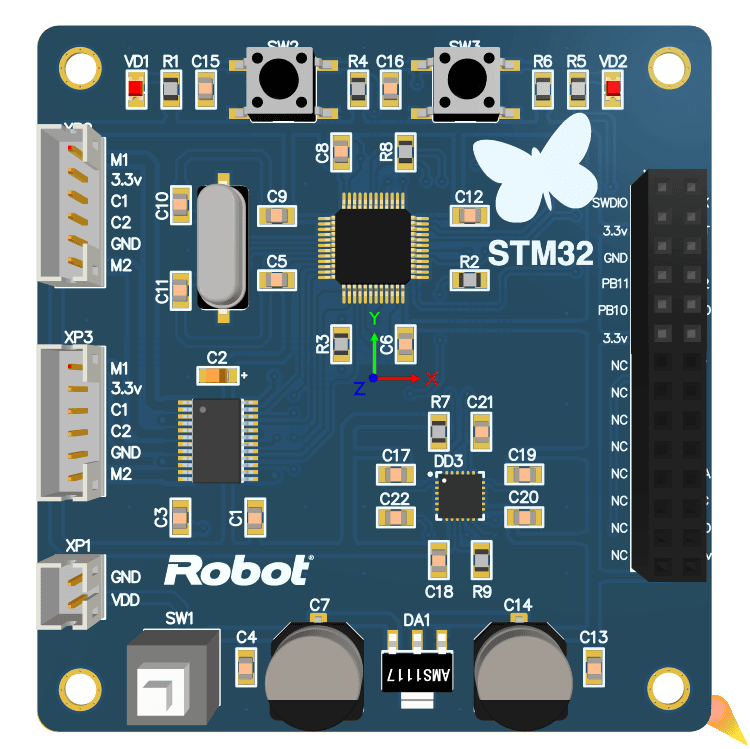
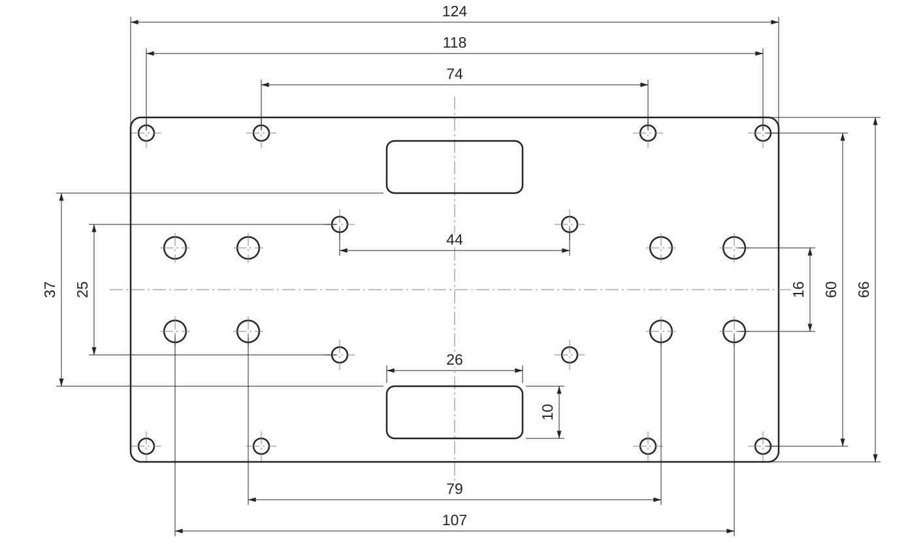

# Hardware

 

[← About the project](../README.md)

## PCB

[PDF schematic](pcb/controller-schematic.pdf) · [Altium project](pcb/controller.PrjPCB)

| Component | Purpose |
| --- | --- |
| STM32F103C8T6 | Controller |
| MPU-6050 | Acceleration and angular velocity |
| TB6612FNG | Dual motor driver |
| AMS1117-3.3 | 3.3 V logic supply |
| 8 MHz crystal | Clock source |
| Two geared motors with encoders | Drive and motion feedback |
| 4×AA battery holder | Power; the board input is marked 6 V |

Pin assignments in the code: PB6/PB7 — I²C, PA0/PA1 — PWM, PA2–PA5 — direction, PA10 — driver standby (STBY), PA6–PA9 — encoders, PA13/PA14 — SWD. These are microcontroller pins, not connector pin numbers. The PDF schematic and PCB layout differ in connector assignments and motor direction signals. Check the PCB connections before wiring.

`controller.PrjPCB` opens the schematic `controller.SchDoc`, the board `controller.PcbDoc`, and the export settings `fabrication.OutJob`. Ready-made Gerber and drill files are not included: the original 2019 fabrication package was not preserved. Open the project in Altium Designer, run `fabrication.OutJob`, and check the output before ordering a board.

### Fabrication parameters

The board was ordered from JLCPCB with these settings. Any PCB service can make it with the same parameters.

| Parameter | Value |
| --- | --- |
| Dimensions | 66 × 63.1 mm |
| Layers | 2 |
| Material | FR-4, TG135 |
| Thickness | 1.6 mm |
| Outer copper | 1 oz |
| Surface finish | HASL with lead (lead-free works just as well) |
| Solder mask / silkscreen | blue / white |
| Via covering | tented |
| Min. via | 0.3 mm hole, 0.45 mm diameter |
| Delivery format | single PCB, no panel |
| Electrical test | flying probe |

The order number was allowed to be printed on the board, so a small code may appear on the silkscreen.

## Acrylic frame

Three acrylic platforms and brass standoffs form the frame. The [base sketch](enclosure/acrylic-platform.svg) shows a 124 × 66 mm platform.

The sketch is based on the original drawing, with symmetry assumed and corner rounds shown approximately. Dimensions are in millimeters. Choose hole diameters and acrylic thickness for your build; prepare a separate cutting outline for laser fabrication.

Choose geared motors with encoders and adapt the mounts to fit. Gear ratio, encoder resolution, and wheel radius affect the control settings; check motor current against the driver rating.

## Embedded models

The PCB file includes 3D component models. Some were drawn for this project, others come from component manufacturers and remain their property. The schematic, board layout, and platform sketch are under the MIT license, see [LICENSE](../LICENSE).
