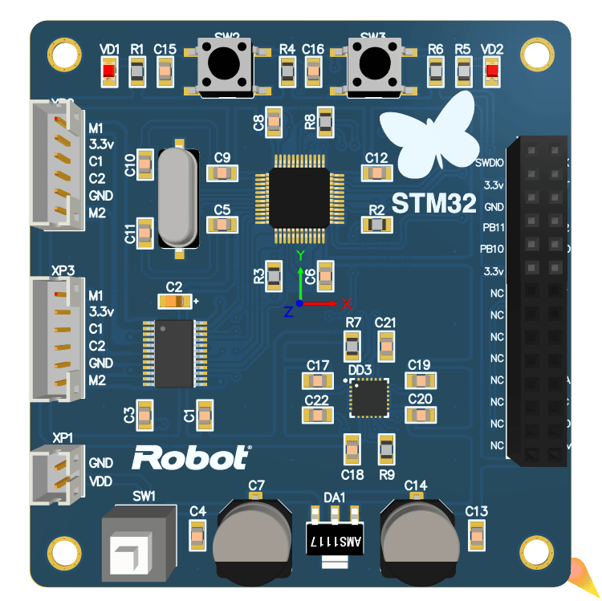
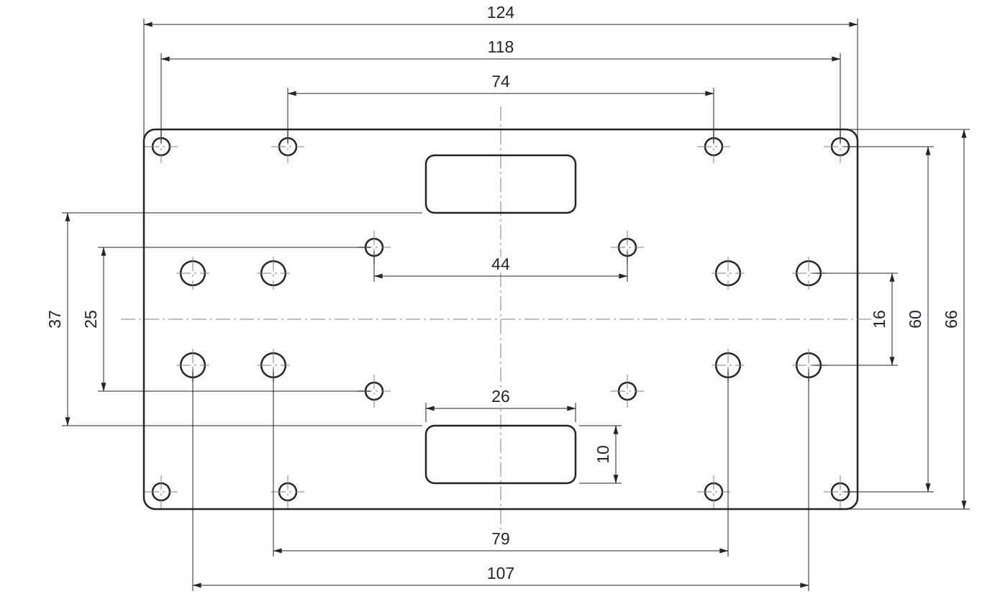

# Железо

 

[← О проекте](../README.ru.md)

## Плата

[Схема в PDF](pcb/controller-schematic.pdf) · [Проект Altium](pcb/controller.PrjPCB)

| Компонент | Для чего |
| --- | --- |
| STM32F103C8T6 | Управление |
| MPU-6050 | Ускорение и угловая скорость |
| TB6612FNG | Два канала управления моторами |
| AMS1117-3.3 | Питание логики 3,3 В |
| Кварц 8 МГц | Тактирование |
| Два мотор-редуктора с энкодерами | Движение и обратная связь |
| Отсек 4×AA | Питание; вход платы обозначен 6 В |

В коде: PB6/PB7 — I²C, PA0/PA1 — ШИМ, PA2–PA5 — направление, PA10 — разрешение драйвера (STBY), PA6–PA9 — энкодеры, PA13/PA14 — SWD. Это выводы микроконтроллера, не номера контактов разъемов. Схема в PDF и разводка платы различаются подключением разъемов и сигналов направления моторов. Перед сборкой сверьте соединения по плате.

`controller.PrjPCB` открывает схему `controller.SchDoc`, плату `controller.PcbDoc` и настройки экспорта `fabrication.OutJob`. Готовых Gerber и сверловки в репозитории нет: производственный пакет 2019 года не сохранился. Откройте проект в Altium Designer, запустите `fabrication.OutJob` и проверьте результат перед заказом.

### Параметры изготовления

Плата заказывалась на JLCPCB с такими параметрами. Любое производство печатных плат примет заказ с теми же настройками.

| Параметр | Значение |
| --- | --- |
| Размер | 66 × 63,1 мм |
| Слои | 2 |
| Материал | FR-4, TG135 |
| Толщина | 1,6 мм |
| Внешняя медь | 1 oz (35 мкм) |
| Покрытие | HASL со свинцом (бессвинцовое подойдет так же) |
| Маска / шелкография | синяя / белая |
| Переходные отверстия | закрыты маской |
| Мин. переходное | отверстие 0,3 мм, площадка 0,45 мм |
| Формат поставки | отдельная плата, без панели |
| Электротест | летающие щупы |

В заказе было разрешено печатать номер заказа на плате, поэтому на шелкографии может появиться небольшой код.

## Корпус из оргстекла

Корпус состоит из трех платформ из оргстекла на латунных стойках. Размер основания — 124 × 66 мм, размеры показаны на [эскизе](enclosure/acrylic-platform.svg).

Эскиз сделан по исходному чертежу: расположение элементов принято симметричным, скругления показаны условно. Размеры в миллиметрах. Диаметры отверстий и толщину оргстекла подберите под свою сборку; для лазерной резки подготовьте отдельный контур.

Выбирайте мотор-редукторы с энкодерами и подгоняйте крепления под них. Передаточное число, разрешение энкодера и радиус колеса влияют на настройку регулятора. Ток моторов должен соответствовать возможностям драйвера.

## Встроенные модели

В файл платы встроены 3D-модели компонентов. Часть нарисована для этого проекта, часть взята у производителей и остается их собственностью. Схема, разводка платы и эскиз платформы распространяются по лицензии MIT, см. [LICENSE](../LICENSE).
